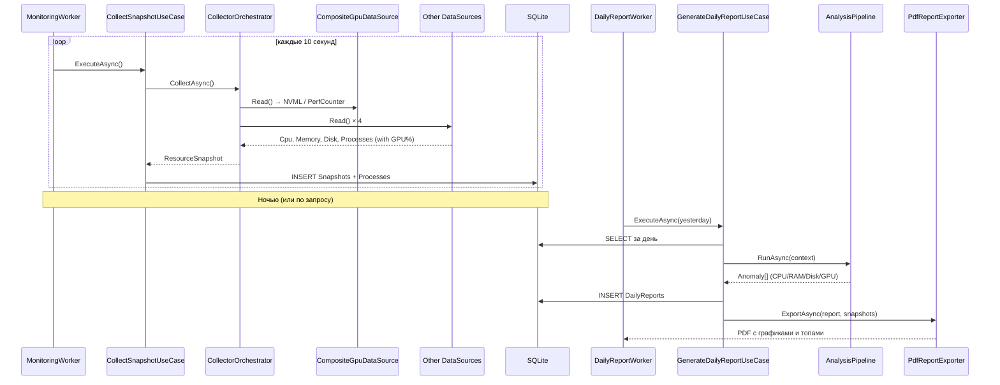

<div align="center">

# 🖥️ PC Monitor

**Мониторинг ресурсов ПК с автоматической генерацией ежедневных отчётов**

[](https://dotnet.microsoft.com/)
[](https://www.microsoft.com/windows)
[](LICENSE)
[](https://learn.microsoft.com/dotnet/csharp/)
[](https://learn.microsoft.com/ef/core/)
[](https://www.sqlite.org/)
[](https://developer.nvidia.com/nvidia-management-library-nvml)

[Возможности](#-возможности) •
[Архитектура](#-архитектура) •
[Установка](#-установка) •
[Запуск](#-запуск) •
[Конфигурация](#-конфигурация) •
[Как это работает](#-как-это-работает) •
[Ограничения](#️-ограничения)

</div>

---

## 📖 О проекте

**PC Monitor** — фоновая служба для Windows, которая отслеживает использование системных ресурсов (**CPU**, **RAM**, **диск**, **GPU**) и сопоставляет нагрузку с конкретными процессами. Раз в сутки программа автоматически формирует **PDF-отчёт** с графиками, топ-потребителями и списком аномалий.

> [!TIP]
> Проект построен по принципам **Clean Architecture** и **SOLID** — это не только рабочий инструмент, но и демонстрация того, как выглядит .NET-приложение с чистым разделением слоёв.

---

## ✨ Возможности

<table>
<tr>
<td width="50%" valign="top">

### 📊 Сбор метрик
- Загрузка **CPU** каждые N секунд
- Использование **RAM** (used / total)
- Скорость **дискового I/O** (read / write), per-process
- **GPU-телеметрия** без установки драйверов:
  - NVIDIA → **NVML** (встроен в драйвер)
  - Intel / AMD → Windows Performance Counters
- Полный список **процессов** с нагрузкой на CPU/RAM/Disk/**GPU**

</td>
<td width="50%" valign="top">

### 🔍 Анализ
- Эпизоды высокой загрузки **CPU** (с минимальной длительностью)
- Устойчивое давление на **память**
- Дисковые всплески **I/O**
- Всплески **GPU utilization**
- **Корреляция** с событиями ОС (антивирус, обновления, драйверы)

</td>
</tr>
<tr>
<td width="50%" valign="top">

### 📄 Отчётность
- Ежедневный **PDF** с графиками CPU, RAM и GPU
- **Сводка по GPU**: загрузка, температура, VRAM
- **Топ-5** потребителей по каждой метрике (CPU / RAM / Диск / GPU)
- Аномалии с виновником и контекстом (топ-3 процесса в момент аномалии)
- Время **в локальном часовом поясе** с явным UTC-offset

</td>
<td width="50%" valign="top">

### 🏗️ Инфраструктура
- Хранение истории в **SQLite** (EF Core)
- Работа как **Windows Service**
- **CLI-режим** для генерации отчёта за любую дату
- Конфигурация через `appsettings.json`
- **Автоопределение вендора GPU** с приоритетом дискретной карты

</td>
</tr>
</table>

---

## 🛠️ Технологии

| Слой | Технология |
|---|---|
| **Платформа** | .NET 9 (C# 13), Windows 10/11 |
| **Domain** | Чистый C#, без внешних зависимостей |
| **Application** | Use Cases, Strategy, Chain of Responsibility |
| **Infrastructure** | EF Core 9, SQLite, OxyPlot + SkiaSharp, QuestPDF |
| **GPU** | NVIDIA NVML (P/Invoke к `nvml.dll`), Windows Performance Counters |
| **System API** | `System.Diagnostics.PerformanceCounter`, `System.Management` (WMI), `P/Invoke` |
| **Hosting** | `Microsoft.Extensions.Hosting`, Worker Service |

> [!NOTE]
> **Нет внешних драйверов.** NVML поставляется вместе с драйвером NVIDIA; Performance Counters — часть Windows. Проект не требует установки PawnIO, WinRing0 или `LibreHardwareMonitor`.

---

## 🏛 Архитектура

Проект разделён на **четыре слоя** по принципам Clean Architecture. Направление зависимостей — **строго внутрь**, к Domain.

```
┌─────────────────────────────────────────────────────────────┐
│  PcMonitor.Presentation.Worker                              │
│  ─ BackgroundService, CLI, Composition Root                 │
└──────────────────────────┬──────────────────────────────────┘
                           │
┌──────────────────────────▼──────────────────────────────────┐
│  PcMonitor.Infrastructure                                   │
│  ─ PerformanceCounter, NVML, EF Core, OxyPlot, QuestPDF     │
└──────────────────────────┬──────────────────────────────────┘
                           │
┌──────────────────────────▼──────────────────────────────────┐
│  PcMonitor.Application                                      │
│  ─ Use Cases, Analyzers, Ports                              │
└──────────────────────────┬──────────────────────────────────┘
                           │
┌──────────────────────────▼──────────────────────────────────┐
│  PcMonitor.Domain                                           │
│  ─ Entities, Value Objects, Domain Events, Ports            │
└─────────────────────────────────────────────────────────────┘
```

**GPU-подсистема** — отдельный пример применения Strategy:

```
CompositeGpuDataSource
  ├── GpuVendorDetector (WMI → PNPDeviceID)
  │     Приоритет: NVIDIA > AMD > Intel > Unknown
  ├── NvidiaNvmlProvider        (NVML via P/Invoke)
  ├── PerformanceCounterGpuProvider  (Intel / AMD / Unknown)
  └── IGpuTelemetryProvider — общий интерфейс
```

Если провайдер вендора не инициализировался — `CompositeGpuDataSource` переключается на `PerformanceCounterGpuProvider` без падения.

---

## 📋 Требования

| Компонент | Версия | Примечание |
|---|---|---|
| **ОС** | Windows 10 / 11 | Linux и macOS не поддерживаются |
| **.NET** | 9.0 SDK | Для сборки; для запуска достаточно Runtime |
| **Права** | Администратор | Для `PerformanceCounter` (диск, часть процессов) |

> [!IMPORTANT]
> **NVML работает без прав администратора** — `nvml.dll` доступна процессу через стандартный поиск Windows. Права администратора нужны только для счётчиков производительности и чтения I/O системных процессов.

---

## 🚀 Установка

### 1. Клонировать репозиторий

```powershell
git clone https://github.com/<username>/PcMonitor.git
cd PcMonitor
```

### 2. Восстановить пакеты и собрать

```powershell
dotnet restore
dotnet build -c Release
```

### 3. Применить миграцию БД (один раз)

```powershell
dotnet ef migrations add InitialCreate `
  --project PcMonitor.Infrastructure `
  --startup-project PcMonitor.Presentation.Worker `
  --output-dir Persistence/Migrations
```

> [!NOTE]
> Миграция применяется автоматически при первом запуске Worker'а. Эта команда нужна только для первоначальной генерации файлов миграции.

### 4. Запустить

```powershell
dotnet run --project PcMonitor.Presentation.Worker
```

**При первом запуске автоматически создаются:**

| Путь | Что |
|---|---|
| `%LOCALAPPDATA%\PcMonitor\monitor.db` | SQLite база данных |
| `%USERPROFILE%\Documents\PcMonitor\Reports\` | PDF-отчёты |

---

## ▶️ Запуск

### 🖥 Консольный режим (для отладки)

```powershell
# ВАЖНО: для UAC-манифеста запускайте exe напрямую, не через dotnet run
& ".\PcMonitor.Presentation.Worker\bin\Debug\net9.0-windows\PcMonitor.Presentation.Worker.exe"
```

Работает в фоне, сбор идёт каждые **10 секунд**. **Ctrl+C** — корректная остановка.

**Ожидаемый вывод при старте:**

```
Reports directory: C:\Users\...\Documents\PcMonitor\Reports
[GPU] Ignoring non-physical device: DameWare Development Mirror Driver 64-bit
[GPU] Found NVIDIA (discrete, priority)
[GPU] Detected vendor: Nvidia
[GPU] NVML initialized: NVIDIA GeForce RTX 5070
[GPU] Active provider: NVIDIA (NVML)
info: Monitoring worker started, interval 00:00:10
info: Daily report worker started, check interval 00:15:00
info: Application started. Press Ctrl+C to shut down.
```

### 📄 Ручная генерация отчёта

```powershell
dotnet run --project PcMonitor.Presentation.Worker -- generate-report 2026-10-30
```

Генерирует PDF за указанную дату (формат `yyyy-MM-dd`) и сохраняет в папку отчётов.

### ⚙️ Windows Service

От имени администратора:

```powershell
sc.exe create PcMonitor `
  binPath= "C:\path\to\PcMonitor.Presentation.Worker.exe" `
  start= auto `
  DisplayName= "PC Monitor"

sc.exe start PcMonitor
```

Логи — в **Event Viewer** → Windows Logs → Application (источник `PcMonitor`).

---

## ⚙️ Конфигурация

Все параметры — в `appsettings.json` (проект **Worker**):

```jsonc
{
  "Worker": {
    // Частота сбора метрик
    "SamplingIntervalSeconds": 10,
    
    // Как часто проверять «пора ли генерировать отчёт»
    "ReportCheckIntervalSeconds": 900,
    
    // Пороги CPU
    "CpuWarnPercent": 70,
    "CpuCriticalPercent": 90,
    "CpuMinDurationSeconds": 30,
    
    // Пороги RAM
    "MemoryWarnPercent": 75,
    "MemoryCriticalPercent": 90,
    
    // Пороги диска (МБ/с)
    "DiskWarnMegabytesPerSecond": 50,
    "DiskCriticalMegabytesPerSecond": 200,
    
    // Пороги GPU
    "GpuWarnPercent": 80,
    "GpuCriticalPercent": 95
  }
}
```

Изменения применяются при следующем запуске.

> [!WARNING]
> Не ставьте `SamplingIntervalSeconds` меньше `5` в production — это перегружает БД. `8640` снимков в сутки при интервале `10` секунд уже дают ~50 МБ данных в месяц.

---

## 💾 Где хранятся данные

| Данные | Путь |
|---|---|
| База данных | `%LOCALAPPDATA%\PcMonitor\monitor.db` |
| PDF-отчёты | `%USERPROFILE%\Documents\PcMonitor\Reports\` |

---

## 📂 Структура проекта

```
PcMonitor/
├── src/
│   ├── PcMonitor.Domain/               ← ядро: сущности, VO, порты
│   │   ├── Common/
│   │   ├── Entities/
│   │   ├── Enums/
│   │   ├── Events/
│   │   ├── Ports/
│   │   ├── Services/
│   │   └── ValueObjects/
│   │
│   ├── PcMonitor.Application/          ← use cases, анализаторы
│   │   ├── Abstractions/
│   │   ├── Analyzers/                  ← CpuSpike, MemoryPressure, DiskBurst, GpuSpike
│   │   ├── DTOs/
│   │   ├── Services/
│   │   └── UseCases/
│   │
│   ├── PcMonitor.Infrastructure/       ← реализации портов
│   │   ├── Calendar/
│   │   ├── Clock/
│   │   ├── DataSources/                ← CompositeGpuDataSource, ProcessDataSource
│   │   ├── Events/
│   │   ├── Gpu/                        ← NvmlNative, NvidiaNvmlProvider,
│   │   │                                  PerformanceCounterGpuProvider, GpuVendorDetector
│   │   ├── Persistence/
│   │   └── Reporting/
│   │
│   └── PcMonitor.Presentation.Worker/  ← фоновая служба
│       ├── Logging/
│       ├── Options/
│       ├── Workers/
│       ├── appsettings.json
│       └── Program.cs
│
└── tests/
    ├── PcMonitor.Domain.Tests/
    └── PcMonitor.Application.Tests/
```

---

## 🔄 Как это работает



### Пошагово

1. **`MonitoringWorker`** каждые `N` секунд вызывает `CollectSnapshotUseCase`.
2. **Use Case** через `CollectorOrchestrator` запрашивает данные у пяти источников.
3. **GPU-источник** (`CompositeGpuDataSource`) определяет вендора и выбирает провайдер.
4. **`ProcessDataSource`** параллельно читает per-process GPU через `GPU Engine` counters (парсит PID из имени инстанса).
5. **Снимок** сохраняется в SQLite.
6. **`DailyReportWorker`** раз в 15 минут проверяет: есть ли отчёт за вчера?
7. **`GenerateDailyReportUseCase`** прогоняет через `AnalysisPipeline`, строит топ по 4 метрикам, экспортирует PDF.

---

## 🔍 Анализаторы аномалий

| Анализатор | Что находит | Минимальная длительность |
|---|---|---|
| **`CpuSpikeAnalyzer`** | Эпизоды устойчиво высокой загрузки CPU | 30 секунд |
| **`MemoryPressureAnalyzer`** | Эпизоды высокого давления на RAM | 5 минут |
| **`DiskBurstAnalyzer`** | Эпизоды интенсивного дискового I/O | 30 секунд |
| **`GpuSpikeAnalyzer`** | Эпизоды высокой загрузки GPU | 30 секунд |
| **`EventCorrelationEnricher`** | Обогащает аномалии контекстом из Event Log | — |

**Пороги значимости** — чтобы не попадали «фантомные» процессы с нулевой нагрузкой:

- CPU: ≥ 0.5%
- RAM: ≥ 1 МБ
- Disk: ≥ 10 КБ/с
- GPU: ≥ 0.5%

Если все процессы ниже порога — виновник остаётся **неопределённым**, и отчёт честно пишет: *«нагрузка, вероятно, от системных процессов (драйверы, прерывания)»*.

---

## ⚠️ Ограничения

### 🔒 Платформа

- **Только Windows.** `PerformanceCounter`, `System.Management`, `Event Log` — Windows-only API.
- **Права администратора** нужны для `PerformanceCounter` (диск, часть процессов). NVML от прав **не зависит**.

### 🎮 GPU

| Сценарий | Что работает | Что не работает |
|---|---|---|
| **NVIDIA, локально** | Загрузка, температура, VRAM, per-process GPU% | — |
| **NVIDIA, RDP** | Только имя устройства | Загрузка = 0, VRAM = 0 (см. ниже) |
| **Intel / AMD, локально** | Загрузка GPU и per-process GPU% | Температура, VRAM |
| **Intel / AMD, RDP** | Только имя устройства | Загрузка = 0 |

> [!CAUTION]
> **RDP / удалённые сессии.** Когда вы подключены через RDP, DameWare или аналогичный инструмент, Windows **обходит физический GPU** — рендеринг идёт на клиенте. `nvmlDeviceGetUtilizationRates` и `GPU Engine` counters возвращают **0%**. Это физическое ограничение, а не баг проекта. Для реальных данных нужно **локальное подключение** к машине (физический монитор).

> [!NOTE]
> **AMD в v1.** Работает через универсальный fallback (Windows Performance Counters). Температура и VRAM недоступны — потребуется ADLX SDK (см. Roadmap).

> [!NOTE]
> **Intel в v1.** Аналогично AMD — только utilization через Performance Counters. Температура и VRAM — потребуется IGCL SDK (см. Roadmap).

### 🖥 Системные процессы

`System (4)`, `Secure System`, `Registry`, `smss`, `csrss` — **всегда 0 Б/с**, потому что Windows не позволяет открыть их даже администратору. Для получения их I/O нужен **ETW** — отдельный уровень сложности.

### 📅 Пропущенные дни

`DailyReportWorker` генерирует отчёт только за **вчера**. Пропущенные дни (когда ПК был выключен) не догоняются автоматически — используйте CLI с конкретной датой.

---

## 🗺 Планы развития

- [ ] **WPF-дашборд** для просмотра данных в реальном времени
- [ ] **VRAM-график** и **температурный график** GPU в отчётах
- [ ] **Intel IGCL** — полная телеметрия Intel iGPU (температура, VRAM)
- [ ] **AMD ADLX** — полная телеметрия AMD GPU
- [ ] **Агрегация топ-потребителей по имени** процесса (сейчас по PID)
- [ ] **Экспорт в HTML** в дополнение к PDF
- [ ] **Уведомления в Telegram** при критических аномалиях
- [ ] **Retention-политика** — автоматическое удаление старых снимков
- [ ] **Кроссплатформенность** (Linux / macOS) через замену `IDataSource<T>`

---

## 🤝 Вклад

Pull requests приветствуются. Для крупных изменений — сначала откройте **issue**, чтобы обсудить подход.

**Перед отправкой PR:**

```powershell
dotnet build -c Release
dotnet test
dotnet format --verify-no-changes
```

---

## 📄 Лицензия

Этот проект распространяется под лицензией **MIT**. См. файл [LICENSE](LICENSE) для подробностей.

---

<div align="center">

**[⬆ Наверх](#️-pc-monitor)**

</div>
