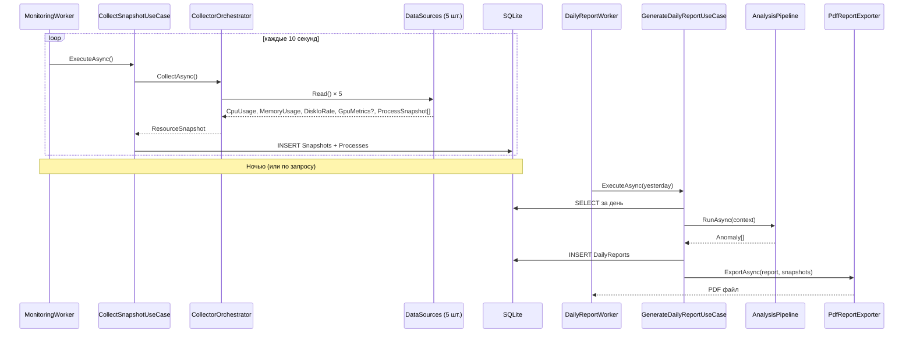

<div align="center">

# 🖥️ PC Monitor

**Мониторинг ресурсов ПК с автоматической генерацией ежедневных отчётов**

[](https://dotnet.microsoft.com/)
[](https://www.microsoft.com/windows)
[](LICENSE)
[](https://learn.microsoft.com/dotnet/csharp/)
[](https://learn.microsoft.com/ef/core/)
[](https://www.sqlite.org/)

[Возможности](#-возможности) •
[Архитектура](#-архитектура) •
[Установка](#-установка) •
[Запуск](#-запуск) •
[Конфигурация](#-конфигурация) •
[Как это работает](#-как-это-работает)

</div>

---

## 📖 О проекте

**PC Monitor** — это фоновая служба для Windows, которая отслеживает использование системных ресурсов (**CPU**, **RAM**, **диск**, **GPU**) и сопоставляет нагрузку с конкретными процессами. Раз в сутки программа автоматически формирует **PDF-отчёт** с графиками, топ-потребителями и списком аномалий.

> [!TIP]
> Проект построен по принципам **Clean Architecture** и **SOLID** — это не только рабочий инструмент, но и демонстрация того, как выглядит .NET-приложение с чистым разделением слоёв.
---

## ✨ Возможности

<table>
<tr>
<td width="50%" valign="top">

### 📊 Сбор метрик
- Загрузка **CPU** каждые N секунд
- Использование **RAM** (used / total)
- Скорость **дискового I/O** (read / write)
- **GPU-сенсоры**: утилизация, температура, VRAM
- Полный список **процессов** с нагрузкой

</td>
<td width="50%" valign="top">

### 🔍 Анализ
- Эпизоды высокой нагрузки (**spikes**)
- Устойчивое давление на память (**pressure**)
- Дисковые всплески (**bursts**)
- **Корреляция** с событиями ОС (антивирус, обновления, драйверы)

</td>
</tr>
<tr>
<td width="50%" valign="top">

### 📄 Отчётность
- Ежедневный **PDF** с графиками
- **Топ-5** потребителей по каждой метрике
- Список аномалий с severity
- CLI для генерации за любую дату

</td>
<td width="50%" valign="top">

### 🏗️ Инфраструктура
- Хранение истории в **SQLite**
- Работа как **Windows Service**
- **CLI-режим** для отладки
- Конфигурация через `appsettings.json`

</td>
</tr>
</table>

---

## 🛠️ Технологии

| Слой | Технология |
|---|---|
| **Платформа** | .NET 9 (C# 13) |
| **Domain** | Чистый C#, без зависимостей |
| **Application** | Use Cases, Strategy, Chain of Responsibility |
| **Infrastructure** | EF Core 9, SQLite, LibreHardwareMonitorLib, OxyPlot, SkiaSharp, QuestPDF |
| **System API** | `System.Diagnostics.PerformanceCounter`, `Event Log`, `P/Invoke` |
| **Hosting** | `Microsoft.Extensions.Hosting`, Worker Service |

---

## 🏛 Архитектура

Проект разделён на **четыре слоя** по принципам Clean Architecture. Направление зависимостей — **строго внутрь**, к Domain.

```
┌─────────────────────────────────────────────────────────────┐
│  PcMonitor.Presentation.Worker                              │
│  ─ BackgroundService, CLI, Composition Root                 │
└──────────────────────────┬──────────────────────────────────┘
                           │
┌──────────────────────────▼──────────────────────────────────┐
│  PcMonitor.Infrastructure                                   │
│  ─ PerformanceCounter, LHM, EF Core, OxyPlot, QuestPDF      │
└──────────────────────────┬──────────────────────────────────┘
                           │
┌──────────────────────────▼──────────────────────────────────┐
│  PcMonitor.Application                                      │
│  ─ Use Cases, Analyzers, Ports                              │
└──────────────────────────┬──────────────────────────────────┘
                           │
┌──────────────────────────▼──────────────────────────────────┐
│  PcMonitor.Domain                                           │
│  ─ Entities, Value Objects, Domain Events, Ports            │
└─────────────────────────────────────────────────────────────┘
```

> **Ключевое правило:** Domain не знает ни о чём снаружи. Никаких `using System.Diagnostics`, `using Microsoft.EntityFrameworkCore` — только чистые бизнес-правила. Всё остальное подключается через **порты** (интерфейсы).
---

## 📋 Требования

| Компонент | Версия | Примечание |
|---|---|---|
| **ОС** | Windows 10 / 11 | Linux и macOS не поддерживаются |
| **.NET** | 9.0 SDK | Для сборки; для запуска достаточно Runtime |
| **Права** | Администратор | Для `PerformanceCounter` и драйвера `LibreHardwareMonitor` |

---

## 🚀 Установка

### 1. Клонировать репозиторий

```powershell
git clone https://github.com/<username>/PcMonitor.git
cd PcMonitor
```

### 2. Восстановить пакеты и собрать

```powershell
dotnet restore
dotnet build -c Release
```

### 3. Применить миграцию БД (один раз)

```powershell
dotnet ef migrations add InitialCreate `
  --project PcMonitor.Infrastructure `
  --startup-project PcMonitor.Presentation.Worker `
  --output-dir Persistence/Migrations
```

> [!NOTE]
> Миграция применяется автоматически при первом запуске Worker'а. Эта команда нужна только для первоначальной генерации файлов миграции.

### 4. Запустить

```powershell
dotnet run --project PcMonitor.Presentation.Worker
```

**При первом запуске автоматически создаются:**

| Путь | Что |
|---|---|
| `%LOCALAPPDATA%\PcMonitor\monitor.db` | SQLite база данных |
| `%USERPROFILE%\Documents\PcMonitor\Reports\` | PDF-отчёты |

---

## ▶️ Запуск

### 🖥 Консольный режим (для отладки)

```powershell
dotnet run --project PcMonitor.Presentation.Worker
```

Работает в фоне, сбор идёт каждые **10 секунд**. Первый снимок появится через 10 секунд после старта. **Ctrl+C** — корректная остановка.

### 📄 Ручная генерация отчёта

```powershell
dotnet run --project PcMonitor.Presentation.Worker -- generate-report 2026-10-29
```

Генерирует PDF за указанную дату (формат `yyyy-MM-dd`) и сохраняет в папку отчётов. Полезно для проверки экспорта, не дожидаясь ночи.

### ⚙️ Windows Service

От имени администратора:

```powershell
sc.exe create PcMonitor `
  binPath= "C:\path\to\PcMonitor.Presentation.Worker.exe" `
  start= auto `
  DisplayName= "PC Monitor"

sc.exe start PcMonitor
```

Логи — в **Event Viewer** → Windows Logs → Application (источник `PcMonitor`).

---

## ⚙️ Конфигурация

Все параметры — в `appsettings.json` (проект **Worker**):

```jsonc
{
  "Worker": {
    // Частота сбора метрик
    "SamplingIntervalSeconds": 10,
    
    // Как часто проверять «пора ли генерировать отчёт»
    "ReportCheckIntervalSeconds": 900,
    
    // Пороги CPU
    "CpuWarnPercent": 70,
    "CpuCriticalPercent": 90,
    
    // Пороги RAM
    "MemoryWarnPercent": 75,
    "MemoryCriticalPercent": 90,
    
    // Пороги диска (МБ/с)
    "DiskWarnMegabytesPerSecond": 50,
    "DiskCriticalMegabytesPerSecond": 200,
    
    // Пороги GPU
    "GpuWarnPercent": 80,
    "GpuCriticalPercent": 95
  }
}
```

Изменения применяются при следующем запуске.

> [!WARNING]
> Не ставьте `SamplingIntervalSeconds` меньше `5` в production — это перегружает БД. `8640` снимков в сутки при интервале `10` секунд уже дают ~50 МБ данных в месяц.

---

## 💾 Где хранятся данные

| Данные | Путь |
|---|---|
| База данных | `%LOCALAPPDATA%\PcMonitor\monitor.db` |
| PDF-отчёты | `%USERPROFILE%\Documents\PcMonitor\Reports\` |

---

## 📂 Структура проекта

```
PcMonitor/
├── src/
│   ├── PcMonitor.Domain/               ← ядро: сущности, VO, порты
│   │   ├── Common/
│   │   ├── Entities/
│   │   ├── Enums/
│   │   ├── Events/
│   │   ├── Ports/
│   │   ├── Services/
│   │   └── ValueObjects/
│   │
│   ├── PcMonitor.Application/          ← use cases, анализаторы
│   │   ├── Abstractions/
│   │   ├── Analyzers/
│   │   ├── DTOs/
│   │   ├── Services/
│   │   └── UseCases/
│   │
│   ├── PcMonitor.Infrastructure/       ← реализации портов
│   │   ├── Calendar/
│   │   ├── Clock/
│   │   ├── DataSources/
│   │   ├── Events/
│   │   ├── Persistence/
│   │   └── Reporting/
│   │
│   └── PcMonitor.Presentation.Worker/  ← фоновая служба
│       ├── Logging/
│       ├── Options/
│       ├── Workers/
│       ├── appsettings.json
│       └── Program.cs
│
└── tests/
    ├── PcMonitor.Domain.Tests/
    └── PcMonitor.Application.Tests/
```

---

## 🔄 Как это работает



### Пошагово

1. **`MonitoringWorker`** каждые `N` секунд вызывает `CollectSnapshotUseCase`.
2. **Use Case** через `CollectorOrchestrator` запрашивает данные у пяти источников: CPU, RAM, Disk, GPU, Processes.
3. **Снимок** сохраняется в SQLite.
4. **`DailyReportWorker`** раз в 15 минут проверяет: есть ли отчёт за вчера? Если нет — запускает генерацию.
5. **`GenerateDailyReportUseCase`**:
   - загружает снимки и системные события за день;
   - прогоняет через `AnalysisPipeline`;
   - вычисляет топ-потребителей;
   - строит доменный агрегат `DailyReport`;
   - сохраняет в БД;
   - экспортирует в PDF.

---

## 🔍 Анализаторы аномалий

| Анализатор | Что находит | Минимальная длительность |
|---|---|---|
| **`CpuSpikeAnalyzer`** | Эпизоды устойчиво высокой загрузки CPU | 1 снимок |
| **`MemoryPressureAnalyzer`** | Эпизоды высокого давления на RAM | 5 минут |
| **`DiskBurstAnalyzer`** | Эпизоды интенсивного дискового I/O | 30 секунд |
| **`EventCorrelationEnricher`** | Обогащает аномалии контекстом из Event Log | — |

---

## ⚠️ Ограничения

- 🔒 **Только Windows** — `PerformanceCounter`, `LibreHardwareMonitor`, `Event Log` являются Windows-only API.
- 🎮 **GPU-мониторинг** работает не везде: Intel iGPU без температурных сенсоров, старые AMD без `memory-used`.
- 🔑 **Права администратора** обязательны — без них GPU-мониторинг отключается (fallback на `NullGpuDataSource`), часть счётчиков возвращает нули.
- 📅 **Отчёт только за вчера.** Пропущенные дни (когда ПК был выключен) не догоняются автоматически — используйте CLI с конкретной датой.
- 🌐 **Локализация имён счётчиков** — `PerformanceCounter` всегда использует английские имена категорий («Processor», «Memory») независимо от локали Windows. Это внутренняя трансляция ОС, не нужно её «русифицировать».

---

## 🗺 Планы развития

- [ ] **WPF-дашборд** для просмотра данных в реальном времени
- [ ] **GPU и Disk I/O** графики в отчётах (сейчас только CPU и RAM)
- [ ] **Агрегация топ-потребителей по имени** процесса (сейчас по PID)
- [ ] **Экспорт в HTML** в дополнение к PDF
- [ ] **Уведомления в Telegram** при критических аномалиях
- [ ] **Retention-политика** — автоматическое удаление старых снимков
- [ ] **Кроссплатформенность** (Linux / macOS) через замену `IDataSource<T>`

---

## 🤝 Вклад

Pull requests приветствуются. Для крупных изменений — сначала откройте **issue**, чтобы обсудить подход.

**Перед отправкой PR:**

```powershell
dotnet build -c Release
dotnet test
dotnet format --verify-no-changes
```

---

## 📄 Лицензия

Этот проект распространяется под лицензией **MIT**. См. файл [LICENSE](LICENSE) для подробностей.

---

<div align="center">

**[⬆ Наверх](#️-pc-monitor)**

Сделано с ❤️ и .NET 9

</div>
